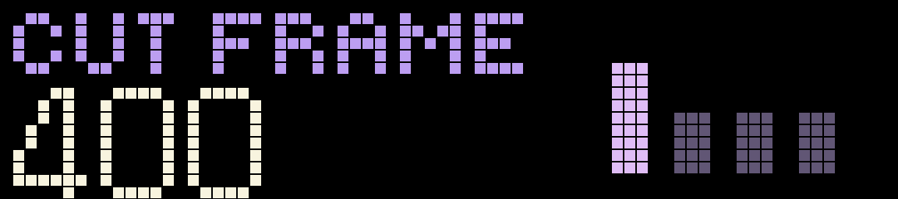
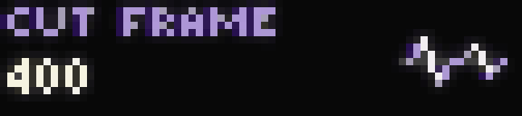

# Frame Sync

Locate a musical beat on an editing timeline at your selected BPM and frame rate.

Place an edit on a specific musical beat without counting frames by hand. The bar gives you both the nearest frame and the time at that frame, including a timeline offset if your music starts after zero.

The frame and time pages show one tick per beat in the selected meter. The taller tick marks the beat used to calculate the cut.

## Find a cut by bar and beat

1. Click to enter tempo, timeline frame rate, beats per bar, bar number, beat and optional offset in frames. Turn to change a field and click to advance.
2. Press **Start** to return to **Cut frame**. The default example puts bar nine, beat one, at frame 400.
3. Turn once to see the corresponding time. The rear identifies the musical time and offset separately.



## Retune an edit to a new tempo

1. Click to enter the editor. Turn the tempo up or down to try a different performance speed. The clip raises 120 BPM to 121 and restores it.
2. Click through the remaining fields if the meter, frame rate or start position also changed. A beat number greater than the meter produces **Outside bar**.
3. Press **Start** to read the revised frame. Use the frame rate of the actual edit timeline.



## Example from the emulator

Eight complete bars of 4/4 contain 32 beat intervals. At 120 BPM that puts the next downbeat 16 seconds from the start. Multiply by 25 fps for frame 400. An offset of 50 frames would move the cut to frame 450.

## Run in the emulator

Open BUSY Bar Emulator. From this repository, run:

```sh
~/.busy-emulator/bin/busy-emulator dev --once
```

Press **Back** to exit.

The GIFs are excerpts from the emulator recording. Each front-display pixel is shown at 9× its original width and height. The end frames pause for reading.

[Full recording](media/controls.mp4) · [Rear display](screenshots/back-1.png) · [Firmware test](EMULATOR-QA.md) · [MIT license](LICENSE)
